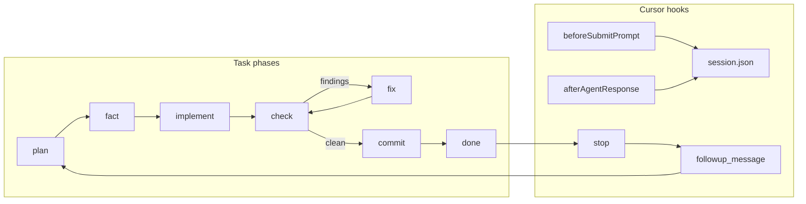

# cursor-pipeline

Autonomous task pipeline for **Cursor Agent**: turn a folder of markdown tasks into a self-driving conveyor — **plan → fact-check → implement → review → fix → commit → next task** — with stop-hooks that keep the same chat moving forward.

Use it when you have a spec broken into ordered tasks (`001-…`, `002-…`) and want long runs without babysitting every handoff.

## How it works



1. You run `/task-pipeline path/to/tasks` in **Agent mode**.
2. State lives in `path/to/tasks/.pipeline/state.json` (status, phase, config). Per-task artifacts go to `.pipeline/runs/<id>/` (`plan.md`, `fact-report.md`, `check-report.md`, `fix-plan.md`, `questions.md`).
3. Task files are renamed to reflect status: `001-foo.md` → `001-foo.in-work.md` → `001-foo.done.md`.
4. **Stop-hook** (`afterAgentResponse` + `stop`) detects pipeline chats, optionally blocks auto-continue when the agent asked a real question, otherwise sends a `followup_message` to resume the current phase or start the next todo (`continueNextTask`, default `true`).

See [docs/how-it-works.md](docs/how-it-works.md) for details on blocked tasks, `questions.md`, and batch mode.

## CI

GitHub Actions (`.github/workflows/test.yml`) runs `./tests/run.sh` on push and pull requests (Node 20). Locally: `./tests/run.sh` (uses a temporary `HOME` so tests do not touch your real `~/.cursor/task-pipeline`).

## Requirements

| Component | Required for |
|-----------|----------------|
| [Cursor](https://cursor.com) with **hooks** and **Agent mode** | IDE pipeline |
| **Node.js** 18+ | `tp-state.mjs`, hooks |
| **jq** | `run-loop.sh` only (batch CLI) |
| **Cursor CLI** (`cursor-agent` or `agent`) | `run-loop.sh` only |
| **macOS** `osascript` | Desktop notifications (optional; skipped elsewhere) |

## Install

```bash
git clone https://github.com/rkolos/cursor-pipeline.git
cd cursor-pipeline
./install.sh
```

Then **Developer: Reload Window** in Cursor.

`install.sh` symlinks commands, rules, and scripts into `~/.cursor` and merges hook entries into `~/.cursor/hooks.json` without removing your other hooks. Runtime state (`~/.cursor/task-pipeline/active.json`, `sessions/`) stays on your machine and is not part of the repo.

| Repo path | Installed to |
|-----------|----------------|
| `commands/*.md` | `~/.cursor/commands/` |
| `rules/task-pipeline-*.mdc` | `~/.cursor/rules/` |
| `scripts/hook.mjs`, `hook.sh`, `tp-state.mjs`, `run-loop.sh` | `~/.cursor/task-pipeline/` |
| `hooks/hooks.json` (fragment) | merged into `~/.cursor/hooks.json` |

Existing files at those paths are backed up to `~/.cursor/task-pipeline-backup-<timestamp>/` before replacing.

### Update

```bash
cd cursor-pipeline && git pull
./install.sh   # idempotent; re-merge hooks if needed
```

Reload Cursor window after updating commands/rules.

### Uninstall

```bash
./install.sh --uninstall
```

Removes symlinks into this repo and pipeline hook entries. Does **not** delete `active.json`, `sessions/`, or task `.pipeline/` folders.

## Usage

### 1. Prepare a task folder

- One markdown file per task, sorted by filename: `001-add-readme.md`, `002-…`
- Each task should describe goal, scope, and definition of done (your format; the agent reads the file).
- Optional: see [docs/examples/tasks](docs/examples/tasks) for a minimal smoke pair.

### 2. Start in Cursor

Open your project, **Agent mode**, new chat:

```
/task-pipeline path/to/tasks
```

The agent runs `node ~/.cursor/task-pipeline/tp-state.mjs` to init (if needed), pick the next task, and walk phases. After a task is **done**, the stop-hook usually starts the next todo in the **same chat**.

### 3. When the pipeline stops

| Situation | What to do |
|-----------|----------------|
| **blocked** | Fill `Ответ:` in `.pipeline/runs/<id>/questions.md` (or add `Рекомендация:` so the agent can auto-fill), then `/task-pipeline` again |
| **awaiting-approval** | Reply ok / continue (only if `gateAfterFact: true` in config) |
| Agent asked a real question | Answer in chat; hook will not auto-continue until you respond |
| **all-done** | Nothing left in `state.json` |

### Configuration (`<tasksDir>/.pipeline/state.json`)

| Key | Default | Meaning |
|-----|---------|---------|
| `gateAfterFact` | `false` | Pause after fact-check for human plan approval |
| `maxCheckRounds` | `2` | Review/fix cycles per task |
| `push` | `true` | `git push` after commit |
| `reviewModel` | `null` | Subagent model for fact/check; null = chat model |
| `continueNextTask` | `true` | Stop-hook starts next todo after done |

Environment:

- `TP_NOTIFY=0` — disable macOS notifications from hooks
- `TP_AUTONOMOUS=1` — set by `run-loop.sh`; skips full precommit, focused tests only

## State CLI

From the project root (or pass `--dir`):

```bash
node ~/.cursor/task-pipeline/tp-state.mjs init path/to/tasks
node ~/.cursor/task-pipeline/tp-state.mjs next
node ~/.cursor/task-pipeline/tp-state.mjs show 001-add-readme
node ~/.cursor/task-pipeline/tp-state.mjs set 001-add-readme --status done --phase done
node ~/.cursor/task-pipeline/tp-state.mjs summary
```

## Batch mode (CLI)

Run many tasks without the IDE (separate branch/worktree recommended; do not run parallel with IDE pipeline on the same workspace):

```bash
~/.cursor/task-pipeline/run-loop.sh path/to/tasks --max-tasks 5 --model composer-2.5
```

| Flag | Meaning |
|------|---------|
| `--max-tasks N` | Stop after N completed tasks (default 1000) |
| `--max-runs-per-task M` | Agent invocations per task before stall (default 12) |
| `--model MODEL` | Pass through to `cursor-agent` |

Exit codes: `0` ok, `2` blocked, `3` no progress, `1` environment error. Logs: `<tasksDir>/.pipeline/logs/`.

## Troubleshooting

**Pipeline stops after every task; model asks “Continue?”**  
Some models end summaries with rhetorical questions. The hook treats pipeline “continue?” phrases as non-blocking; update to the latest `hook.mjs` from this repo. End task summaries with a statement (“Next: `008-…`.”), not a question.

**Hooks never run**  
Confirm `~/.cursor/hooks.json` contains `./task-pipeline/hook.sh` entries. Ensure `node` is on PATH (hook.sh checks homebrew/volta/nvm).

**`tp-state: нет активной папки`**  
Run `init` with your tasks path or start `/task-pipeline <folder>`.

**Two tasks in-progress**  
Only one task may be `in-progress`; finish or reset via `tp-state set`.

## Language note

Slash command text (`commands/*.md`), Cursor rules (`rules/*.mdc`), and some agent-facing strings in scripts are **Russian** today. The agent follows them regardless of your UI language. English prompts are planned as a follow-up; documentation in this repo is English.

## Repository layout

```
commands/     Slash commands: /task-pipeline, tp-fact, tp-check
rules/        Always-on pipeline behavior for the agent
scripts/      hook.mjs, tp-state.mjs, run-loop.sh, merge-hooks.mjs (install only)
hooks/        Hook fragment merged by install.sh
tests/        ./tests/run.sh
docs/         Deep dive + example task folder
install.sh    Symlink installer
```

## Development

```bash
./tests/run.sh
```

See [CONTRIBUTING.md](CONTRIBUTING.md).

## License

Apache-2.0 — see [LICENSE](LICENSE).
